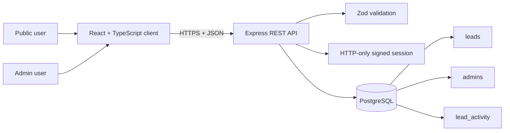
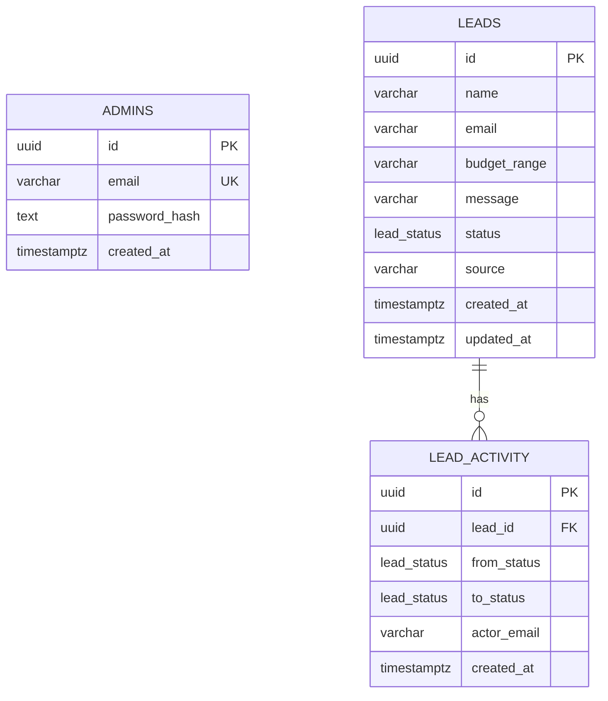

# LeadDesk Mini

A focused lead-capture and follow-up product built for the Digital Heroes Full Stack Development qualification task.

LeadDesk Mini has two deliberately different experiences:

1. **Public intake:** a responsive landing page with a short project form, client-side validation, clear submission states, and a required Digital Heroes credit.
2. **Admin workspace:** authenticated lead search, status management, metrics, responsive layouts, and an audit trail for every status change.

> Product principle: **signal, not CRM clutter.** The application collects only the context needed for a useful first response and makes ownership visible after submission.

## Live submission links

Replace these before sending the assignment:

- Public landing page: `ADD_LIVE_FRONTEND_URL`
- Admin page: `ADD_LIVE_FRONTEND_URL/admin`
- API health check: `ADD_LIVE_API_URL/api/health`
- Loom walkthrough: `ADD_LOOM_URL`
- Demo admin email: `ADD_DEMO_EMAIL`
- Demo admin password: share in the private submission note, not in the public repository

## What is included

### Public experience

- Responsive landing page built for mobile, tablet, and desktop
- Lead form: name, email, budget range, and project message
- React Hook Form + Zod client validation
- Express + Zod server validation
- Loading, success, rate-limit, validation, and network-error states
- Accessible labels, keyboard focus, semantic sections, and reduced-motion support
- Exact required footer credit linked to `digitalheroesco.com`

### Admin experience

- Real email/password login
- Passwords hashed with bcrypt
- Signed session token stored in an HTTP-only cookie
- Protected `/admin` API and client route
- Lead metrics: total, new, contacted, closed, and recent volume
- Search across name, email, and project message
- Status filter and pagination
- Optimistic status updates with rollback on failure
- Lead detail drawer with full context and activity history
- Responsive table on desktop and cards on smaller screens
- Empty, loading, error, and expired-session states

### Engineering quality

- TypeScript across frontend and backend
- Parameterized PostgreSQL queries
- Database indexes for common filters
- Transactional status change + audit log write
- Consistent API error envelope with request IDs
- Helmet security headers, explicit CORS, JSON size limit, rate limiting, and graceful shutdown
- Unit tests for validation rules and UI status rendering
- Docker Compose for local PostgreSQL
- Deployment blueprint and environment examples

## Architecture



The frontend and backend are separate deployable applications. This makes the REST boundary visible, keeps backend validation independent of the browser, and closely reflects a real agency delivery environment.

## Data model



`lead_activity` is separated from `leads` so the current state stays fast to query while status history remains append-only and auditable.

## Authentication approach

1. An admin is seeded through environment variables; the password is hashed with bcrypt before storage.
2. Login compares the submitted password to the stored hash.
3. The server signs an eight-hour token containing only admin ID, email, and role.
4. The token is stored in an HTTP-only cookie, so browser JavaScript cannot read it.
5. Production cookies use `Secure` and cross-site-compatible `SameSite=None` because the frontend and API may be deployed on different domains.
6. Every admin route verifies issuer, audience, signature, and expiry before executing.

A demo password should be shared privately in the Drive submission, never committed to GitHub.

## API contract

| Method | Route | Access | Purpose |
|---|---|---|---|
| `GET` | `/api/health` | Public | Deployment health check |
| `POST` | `/api/leads` | Public, rate-limited | Create a validated lead |
| `POST` | `/api/auth/login` | Public, rate-limited | Start an admin session |
| `POST` | `/api/auth/logout` | Public | Clear the session cookie |
| `GET` | `/api/auth/me` | Admin | Verify current session |
| `GET` | `/api/admin/stats` | Admin | Return lead summary counts |
| `GET` | `/api/admin/leads` | Admin | Search, filter, and paginate leads |
| `GET` | `/api/admin/leads/:id` | Admin | Return lead and activity history |
| `PATCH` | `/api/admin/leads/:id/status` | Admin | Update status transactionally |

### Error envelope

```json
{
  "error": {
    "code": "VALIDATION_ERROR",
    "message": "Please check the highlighted fields",
    "details": {
      "email": ["Enter a valid email address"]
    },
    "requestId": "7df8..."
  }
}
```

The request ID is returned to the browser and logged by the API, making a production issue easier to trace without exposing internals.

## Five deliberate design decisions

### 1. Keep the form short, but make the message useful
The brief requires four fields. I did not add phone number, company size, or a forced booking step. Instead, the message has a 20-character minimum and specific prompt copy so the first response can be useful.

### 2. Separate current status from status history
A lead row stores the current status for fast filtering. Every change also writes an append-only activity record in the same database transaction. This supports handoffs and avoids “who changed this?” ambiguity.

### 3. Use an HTTP-only cookie instead of local storage
Local storage is easy to demo but exposes the token to browser JavaScript. The cookie approach is safer and still works with a separately deployed React client when CORS and credentials are configured explicitly.

### 4. Optimistic status updates with rollback
The dashboard updates immediately, then confirms the API result. If the request fails, the previous query snapshots are restored and the user sees a clear toast. The UI feels fast without hiding failure.

### 5. Show operational metrics, not decorative charts
The assignment is a lead-management workflow, so I used decision-oriented counts rather than a chart with too little data. “New,” “Contacted,” “Closed,” and seven-day volume answer concrete queue questions.

## Local setup

### Prerequisites

- Node.js 20+
- Docker Desktop or a running PostgreSQL database

### 1. Clone and install

```bash
git clone YOUR_REPOSITORY_URL
cd LeadDesk_Mini_Shreya_Lanka
npm install
```

### 2. Start PostgreSQL

```bash
docker compose up -d postgres
```

### 3. Configure environment variables

Run the cross-platform setup command from the project root:

```bash
npm run setup
```

It creates `server/.env` and `client/.env` and generates a strong local JWT secret. Existing files are never overwritten. For local development, the generated database URL matches Docker Compose.

Manual PowerShell alternative:

```powershell
Copy-Item server\.env.example server\.env
Copy-Item client\.env.example client\.env
```

When copying manually, replace the example `JWT_SECRET` with a random value containing at least 32 characters.

### 4. Create tables and demo admin

```bash
npm run db:migrate --workspace server
npm run db:seed --workspace server

# Optional: add realistic sample leads for the evaluator
npm run db:seed-demo --workspace server
```

### 5. Run both applications

```bash
npm run dev
```

- Client: `http://localhost:5173`
- API: `http://localhost:4000`
- Admin: `http://localhost:5173/admin`


## Troubleshooting

### `Environment validation failed`

The API intentionally refuses to start without `DATABASE_URL` and `JWT_SECRET`. From the repository root, run:

```bash
npm run setup
```

Then start PostgreSQL and run the migrations before seeding.

### `pinoHttp has no call signatures`

The server uses a small CommonJS-to-ESM interop wrapper for `pino-http`, which avoids the TypeScript `NodeNext` declaration mismatch on Windows and Node.js 22.

## Tests and quality checks

```bash
npm run test
npm run typecheck
npm run build
```

The included tests cover:

- Valid lead normalization
- Invalid email rejection
- Vague-message rejection
- Pagination guardrails
- Login input normalization
- Human-readable status rendering

A production extension would add API integration tests against a disposable PostgreSQL database and browser-level tests for the public-to-admin flow.

## Deployment checklist

### Database

1. Create a PostgreSQL database.
2. set `DATABASE_URL` on the API host.
3. Run `npm run db:migrate` and `npm run db:seed` once.

### API

Set:

- `NODE_ENV=production`
- `DATABASE_URL`
- `CLIENT_ORIGIN` to the exact frontend origin
- `JWT_SECRET`
- `ADMIN_EMAIL`
- `ADMIN_PASSWORD`

Build command: `npm install && npm run build`  
Start command: `npm run db:migrate && npm start`

### Client

Set `VITE_API_URL` to the deployed API origin, then deploy the `client` directory.

### Fresh-browser verification

- Open the public URL in an incognito window.
- Submit a valid lead and confirm the success state.
- Submit invalid input and confirm client validation.
- Sign in through `/admin/login`.
- Confirm the new lead appears.
- Search it, change its status, refresh, and confirm persistence.
- Open the detail drawer and confirm the status activity entry.
- Sign out and confirm `/admin` is protected.
- Confirm the Digital Heroes footer link is visible.

## Repository structure

```text
.
├── client/                 # React, TypeScript, Tailwind, React Query
│   └── src/
│       ├── components/
│       ├── hooks/
│       ├── lib/
│       └── pages/
├── server/                 # Express, TypeScript, PostgreSQL
│   ├── src/
│   │   ├── config/
│   │   ├── db/
│   │   ├── middleware/
│   │   ├── routes/
│   │   ├── schemas/
│   │   └── services/
│   └── tests/
├── docs/                   # Architecture, decisions, API, and test plan
├── submission-kit/         # Loom script, AI note, and final checklist
├── docker-compose.yml
└── render.yaml
```

## What I would improve with another day

- Add PostgreSQL-backed refresh-token rotation or server-side sessions for immediate revocation.
- Add Playwright tests for submission, login, search, and status update.
- Add controlled sorting and CSV export after validating that the team actually needs them.
- Add a small SLA indicator based on lead age, not a generic “priority score.”
- Self-host or bundle fonts to eliminate third-party font requests.

## AI usage

See [`submission-kit/AI_USAGE.md`](submission-kit/AI_USAGE.md). The note explains where AI accelerated the work and what was changed through manual judgment.
